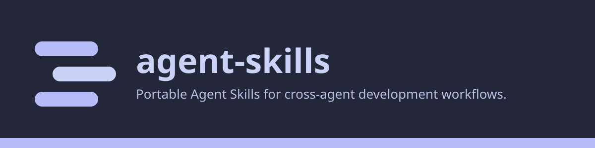

<p align="center">
  
</p>

# Agent Skills

Portable, public [Agent Skills](https://agentskills.io/) for coordinating AI
coding agents across repositories and harnesses. Documentation:
<https://fnayou.github.io/agent-skills/>.

The skills contain tool-independent operating policy. Repository-specific
commands and infrastructure rules stay in each project's own instructions.

## Skills

### `worktree-lanes`

Establishes the current Git worktree lane, the primary lane, the integration
branch, and any project-declared shared resources before parallel work. It also
defines safe rules for lane handoff and cleanup.

The canonical vocabulary is in
[`skills/worktree-lanes/references/terminology.md`](skills/worktree-lanes/references/terminology.md).

### `project-presentation`

Audits, bootstraps, or aligns a repository's visual identity. The brand track
covers the Catppuccin Macchiato foundation with a per-project accent, a
Git-tracked SVG-first workflow, a deterministic generator, and a freshness
check. The documentation track covers a Zensical site in `website/`, an
offline site checker, and GitHub Pages deployment through Actions. Each track
works without the other. The skill carries starter templates and inspects the
repository first, asking only about missing or conflicting choices.

### `agent-browser`

Gives agents a browser that is never the user's own, through three MCP
servers: `playwright` (headless, in-memory profile), `playwright-auth`
(headed, persistent agent-only profile for sites the user signs in to), and
`safari-mcp` (Safari's built-in MCP server for compatibility checks). One
launcher holds the package pin and browser binary for every client, and a
read-only check reports which clients declare each server and whether the
browser, profile, and output directories are ready. Client setup for Claude
Code, Codex, OpenCode, and Pi is in
[`skills/agent-browser/references/setup.md`](skills/agent-browser/references/setup.md).

### `project-bootstrap`

Creates, adopts, or audits a project's engineering foundation with guarded
file generation, GitHub governance templates, and an opt-in Taskfile/Docker
workflow. Audit is read-only; publishing and Git writes require separate
approval. See [`skills/project-bootstrap/SKILL.md`](skills/project-bootstrap/SKILL.md).

### `foreman-workers`

Runs the session as a foreman for a task the operator delegates explicitly:
it plans, writes the brief, and verifies, while worker agents execute in
herdr or Rex panes the operator can watch. The foreman changes nothing itself. Work that can be written as exact steps goes to pi on a local model;
work that needs investigation goes to a paid worker, which may draft the steps
for pi.

- **Requires** a terminal multiplexer, with the foreman session running inside
  one of its panes: herdr (`HERDR_ENV=1`, built against 0.9.3) or Rex
  (`REX_SESSION` set; a preview, probed on 0.1.0-preview.14). With neither, the
  skill says so and works the normal way.
- **Foreman:** Claude Code is the reference foreman. Another harness runs as
  an unprofiled foreman and says so in its first message.
- **Worker kinds** with a profile: `pi`, `claude`, `opencode`, and `codex`.
  Any other kind the multiplexer starts is handled as an unprofiled kind, with every
  dialog left to the operator.
- **Optional files** in `~/.config/foreman-workers/`, copied from the templates
  in the skill: `machine.md` (machine facts: local model, output-condensing
  hooks, the shell tool's time limit), `operator-rules.md` (the operator's own
  rules for workers), and `run-log.md` (one row per run). Without them the
  skill carries on with the worker rules only and records nothing.

Ask for it by name: "use pi workers", "herdr workers", "a worker pane", or
"delegate this through herdr". The vocabulary is in
[`skills/foreman-workers/references/terminology.md`](skills/foreman-workers/references/terminology.md),
and its decisions are in `docs/adr/foreman-workers-*.md`.

## Install

Review the repository before installing it. The installer creates two
symlinks for each skill under `skills/` and refuses to replace any existing
file, directory, or different symlink. It inspects every destination first, so
a conflict leaves all targets untouched.

```sh
./scripts/install
./scripts/install --check
```

The links are:

```text
~/.agents/skills/<skill>  -> <checkout>/skills/<skill>
~/.claude/skills/<skill>  -> <checkout>/skills/<skill>
```

`<skill>` is each directory under `skills/` with a `SKILL.md` entrypoint.

Codex, OpenCode, and Pi discover the shared Agent Skills location. Claude Code
uses its compatible personal-skills location. Both links resolve to the same
source, so the skill cannot drift between agents.

### Per-skill matrix

What the installer links for each harness, and what each skill needs beyond
the link. "Not tested" means nothing in this repository records a run of that
skill in that harness.

| Skill | Claude Code | Codex | OpenCode | Pi |
|---|---|---|---|---|
| *every skill: link* | `~/.claude/skills/<skill>` | `~/.agents/skills/<skill>` | `~/.agents/skills/<skill>` | `~/.agents/skills/<skill>` |
| `worktree-lanes` | Nothing else documented. | Nothing else documented. | Nothing else documented. | Nothing else documented. |
| `project-presentation` | `python3`; `rsvg-convert` for raster brand assets; the packages in `requirements-docs.txt` (Zensical) for the documentation track. | Same as Claude Code. | Same as Claude Code. | Same as Claude Code. |
| `agent-browser` | `claude mcp add -s user` for `playwright`, `playwright-auth`, and `safari-mcp`. | `[mcp_servers.*]` entries in `${CODEX_HOME:-~/.codex}/config.toml`. | `mcp.servers` entries in `~/.config/opencode/opencode.jsonc` (OpenCode 2.x). | `mcpServers` entries in `${PI_CODING_AGENT_DIR:-~/.pi/agent}/mcp.json`. |
| `project-bootstrap` | `python3`; an authenticated `gh` for any GitHub work; the Matt Pocock setup skill for Create and Adopt. | Same as Claude Code. | Same as Claude Code. | Same as Claude Code. |
| `foreman-workers` | herdr (`HERDR_ENV=1`) or Rex (`REX_SESSION`, preview), with the session inside one of its panes; at least one worker agent it can start; optional files in `~/.config/foreman-workers/`. The reference foreman. | Same needs as Claude Code. Restart codex after linking: an open session does not see a new skill. Runs as an unprofiled foreman. | Same needs as Claude Code. Runs as an unprofiled foreman. | Not tested as a foreman. |

`agent-browser` client entries are spelled out in
[`skills/agent-browser/references/setup.md`](skills/agent-browser/references/setup.md).

The target roots can be overridden for testing:

```sh
AGENT_SKILLS_TARGET=/tmp/agents-skills \
CLAUDE_SKILLS_TARGET=/tmp/claude-skills \
./scripts/install
```

### Install with a coding agent

To have a coding agent do the installation, paste this prompt into it. It
needs bash and symbolic links (macOS, Linux, or WSL). The checkout must stay
in a persistent location that you choose, because the installed links point
into it; moving or deleting the checkout breaks them.

```text
Install the skills from https://github.com/fnayou/agent-skills.git for me. This needs bash and symbolic links (macOS, Linux, or WSL); stop if
either is missing.

Work in two phases. Phase 1 changes nothing on my computer; the only
exception is the inspection clone in step 4, which needs its own
permission. Phase 2 starts only after I explicitly approve both cloning
into the agreed path, if the checkout is not there yet, and creating the
links.

Phase 1 - inspect and explain.
1. Ask me for the full final path of the checkout. You may suggest a
   persistent path, but I decide. Never use a temporary location.
2. List each skill under skills/ that has a SKILL.md entrypoint. Work out the two link roots,
   each on its own, because one variable may be set while the other is not:
   - $AGENT_SKILLS_TARGET if AGENT_SKILLS_TARGET is set and non-empty,
     otherwise ~/.agents/skills
   - $CLAUDE_SKILLS_TARGET if CLAUDE_SKILLS_TARGET is set and non-empty,
     otherwise ~/.claude/skills
   Each skill gets one link in each root, named after the skill. Before
   reading or running anything stored locally, check what already exists at
   the checkout path and at every one of those actual link paths. If
   either variable is set and non-empty, tell me the exact resulting paths
   and ask whether to continue with them.
3. If a checkout already exists at that path, confirm that it comes from
   fnayou/agent-skills on GitHub (HTTPS or SSH address) and has no
   uncommitted changes. Tell me its branch and commit. Then find the
   remote's default branch and its latest commit with a read-only lookup
   that fetches nothing and changes nothing (for example
   git ls-remote --symref origin HEAD). The checkout is suitable only if
   it is on that default branch and its current commit equals that remote
   commit. If its origin, cleanliness, branch, or commit does not match or
   cannot be determined, stop and ask. Do not pull, fetch, switch
   branches, reset, stash, change any refs, or install it as it is unless
   I approve a specific plan for that.
4. Read README.md, AGENTS.md, scripts/install, and scripts/verify. Use the
   existing checkout if step 3 found it suitable. Otherwise read them
   online from the public repository. Only if you cannot browse it, ask me
   for separate permission to clone into the agreed path solely to inspect
   the files. That permission does not cover installing.
5. Tell me in plain language exactly what would be created, where, and what
   each link would point to. Then ask for my explicit approval of both
   actions: cloning into the agreed path, if the checkout is not there
   yet, and creating the links.

Phase 2 - clone if needed and install, only after that approval.
6. If the checkout is not there yet, clone into the agreed path. Then
   re-read the four files in the local checkout before running anything,
   and stop if they differ in any way that matters from what you explained.
7. From the checkout, run exactly ./scripts/verify, then ./scripts/install,
   then ./scripts/install --check.
8. Report every resulting link and where it points, plus anything that
   failed. Remind me that moving or deleting the checkout breaks the links.

Stop and ask me instead of continuing if:
- the checkout path or any actual link path already holds something
  different or conflicting. Never overwrite, delete, move, reset, stash, or
  otherwise alter it.
- any command fails or reports something you did not expect.

Do not print or copy secrets, credentials, or tokens. Do not install
anything else, change other settings, or widen the task beyond these steps
without asking me.
```

## Project lane contracts

The global skill deliberately does not prescribe container names, task-runner
commands, secret-copy rules, branch naming, or merge policy. A project that
shares mutable resources between lanes should declare those details in its
repository instructions and expose safe ownership checks and claim commands.

## Verify

```sh
./scripts/verify
```

Verification runs offline and never changes links in your home directory. It
checks:

- every skill: `SKILL.md` frontmatter, a name that matches its directory, a
  description, no machine-specific `/Users/` path, and relative links in
  `SKILL.md` and `references/*.md` that resolve;
- `worktree-lanes`: its terminology and manager-workspace references and their
  required terms and sections;
- `scripts/install` and `scripts/verify` parse; installation, `--check`, link
  targets, refusal to replace an existing path or a different symlink, and
  all-or-nothing behavior across both targets, in an isolated temporary
  directory;
- `project-presentation` starters: the brand generator passes on fresh output
  and fails on stale output; the documentation checker accepts a valid site,
  requires `og:image` when asked, and rejects a broken site;
- `agent-browser`: its scripts are linked, executable and parse; the launcher
  reads its config without executing a value; the check reports declared
  servers, a bypassed launcher, a missing client config, and a stale profile
  lock;
- `project-bootstrap`: its unit tests pass and its scripts parse;
- `foreman-workers`: the files `SKILL.md` links to exist, its terminology
  exists, every Python file under `tests/` compiles, and the scenario fixture
  builds and passes its own check (`RESULT 00-fixture PASS`).

CI also runs ShellCheck on `scripts/` and `skills-ref validate` on each skill.
The scenario runs of `foreman-workers` need herdr or Rex and live agents; they are not
part of verification: see
[`skills/foreman-workers/tests/README.md`](skills/foreman-workers/tests/README.md).

## License

MIT
